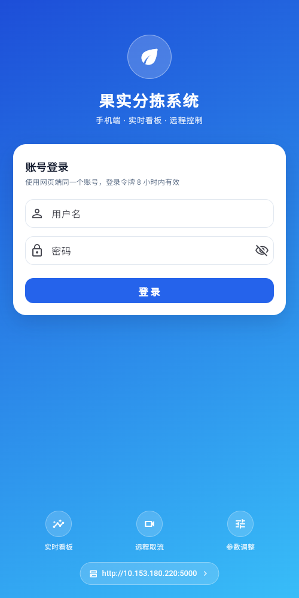
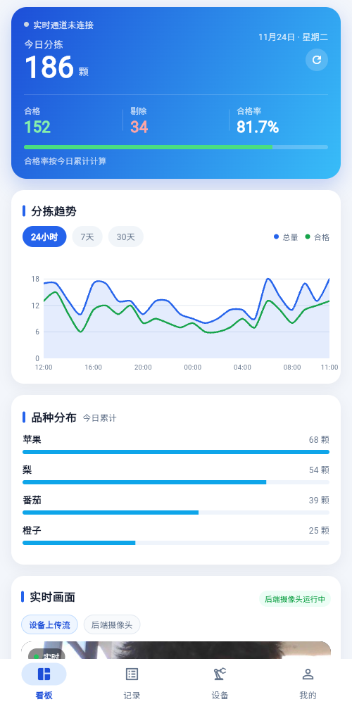
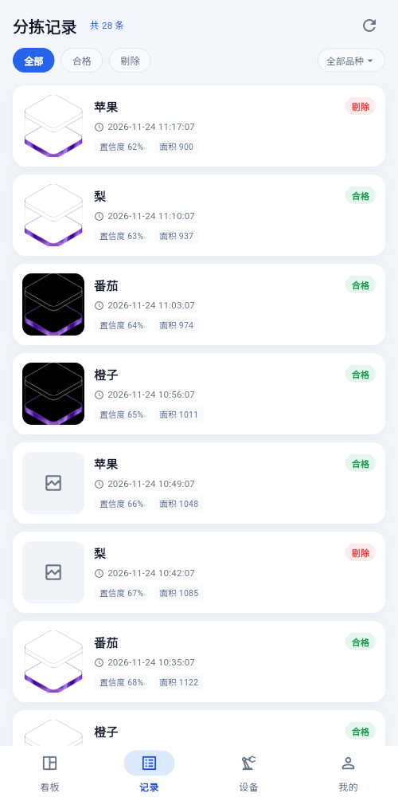
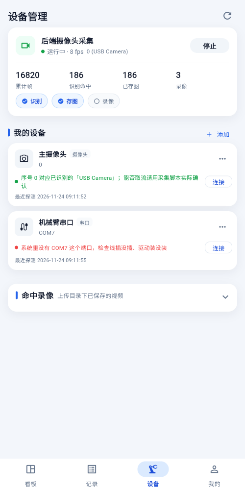
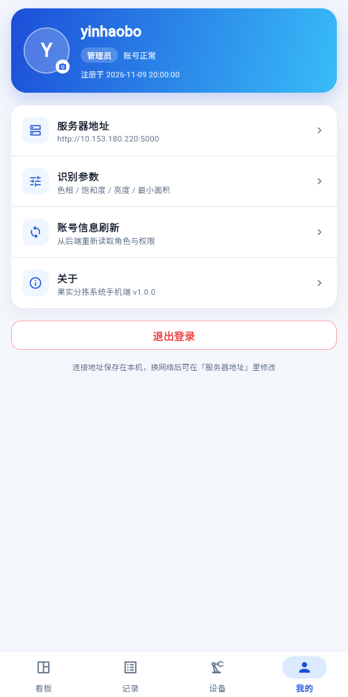

# 果实分拣系统 · 手机端（Flutter）

基于 OpenMV 的果实智能分拣系统移动客户端，与 `backend` 下的 Flask 后端、`frontend` 网页端共用同一套接口和账号体系。

## 功能

| 模块 | 说明 |
| --- | --- |
| 登录 | 与网页端同一账号，JWT 有效期 8 小时；令牌失效会自动回登录页 |
| 看板 | 今日总数 / 合格 / 剔除 / 合格率，24 小时·7 天·30 天趋势曲线，品种分布，最新识别，SocketIO 实时刷新 |
| 实时画面 | 设备上传流（`/api/device/stream`）与后端摄像头（`/api/device/live`）两种来源，MJPEG 解码显示 |
| 记录 | 分页加载、按结果与品种筛选、记录详情、管理员删除 |
| 设备 | 后端摄像头采集状态、启动/停止、识别/存图/录像开关，我的设备（探测/连接/删除/新增），命中录像列表 |
| 我的 | 头像上传与恢复默认、服务器地址、账号信息刷新、识别参数（管理员）、退出登录 |

## 首次使用

1. 手机与运行后端的电脑连接同一个 WiFi。
2. 打开 App，登录页底部的地址默认是 `http://10.153.180.220:5000`（本机 WLAN 网段）。如果电脑 IP 变了，点它改成 `http://电脑IP:5000`。
3. 用后端账号登录（默认管理员见 `backend/.env` 的 `DEFAULT_ADMIN_USER` / `DEFAULT_ADMIN_PASSWORD`）。

> 后端需要以 `0.0.0.0:5000` 监听，Windows 防火墙要放行 5000 端口，否则手机连不上。

## 安装

安装包已构建好：`果实分拣手机端_v1.0.0.apk`（项目根目录，约 52 MB，通用包，含 arm64/armeabi-v7a/x86_64）。

1. 把 APK 传到手机（微信文件传输、数据线、网盘均可），点击安装。
2. 首次安装需在系统里允许「安装未知来源应用」；若提示风险，选择「继续安装」即可（本包未上架应用商店，属于自签名调试/演示版本）。
3. 打开后按上一节的地址说明连接后端。

## 界面预览

| 登录 | 看板 | 记录 |
| --- | --- | --- |
|  |  |  |

| 设备 | 我的 |
| --- | --- |
|  |  |

> 截图来自本地模拟数据（`docs/screenshots`），仅用于展示布局，数值不是真实分拣结果。

## 打包

```bash
cd mobile_app
flutter pub get
flutter build apk --release
# 产物：build/app/outputs/flutter-apk/app-release.apk
```

## 目录结构

```
lib/
├── main.dart                 # 入口、主题、登录态门禁
├── core/
│   ├── api_client.dart       # 后端接口封装、错误提示、头像上传
│   ├── app_state.dart        # 服务器地址 / 令牌 / 当前用户
│   ├── models.dart           # 与接口字段对应的模型
│   ├── realtime_service.dart # SocketIO：new_record / live_frame
│   └── theme.dart            # 蓝白配色、卡片、通用组件
├── pages/                    # 登录、看板、记录、设备、我的、参数、详情
└── widgets/                  # MJPEG 画面、服务器地址弹窗
```

## 说明

- 后端地址保存在本机（SharedPreferences），换网络后到「我的 → 服务器地址」修改；修改会自动退出登录，避免把旧服务器的令牌用到新地址。
- 摄像头启动、开关、设备增删、记录删除、参数保存均要求管理员，操作员只能查看；后端本身也会二次校验权限。
- Android 已开启明文 HTTP（`usesCleartextTraffic`），因为局域网后端是 `http://` 而非 https。
- 应用图标与名称：桌面显示「果实分拣」，图标为蓝底白苹果（`android/app/src/main/res/mipmap-*/ic_launcher.png`），要换图标直接替换这五个尺寸的 PNG。
- `android/build.gradle.kts` 末尾统一关闭了 lint 任务：本机 JDK 17 下 AGP 的 lint 检测器会崩溃（`CommentDetector` 报 `NoSuchMethodError`），关闭后 release 打包正常，不影响运行。
